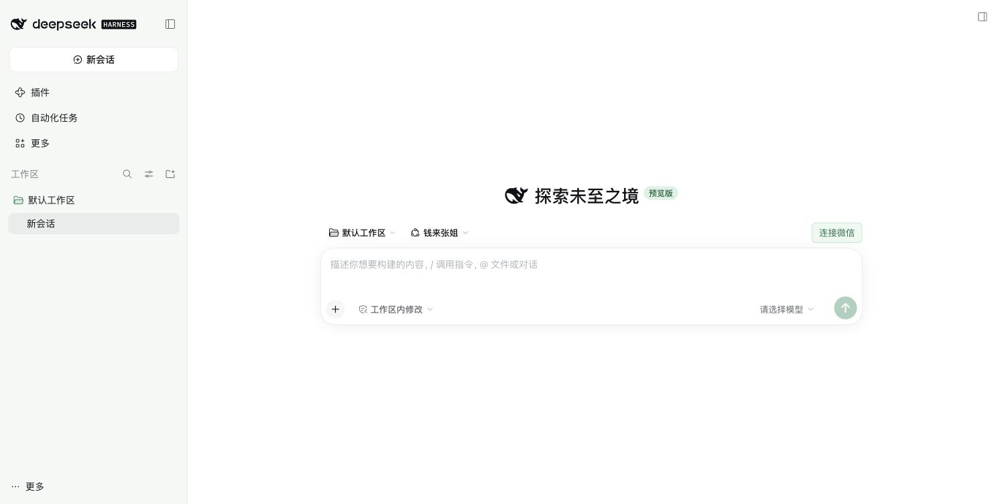
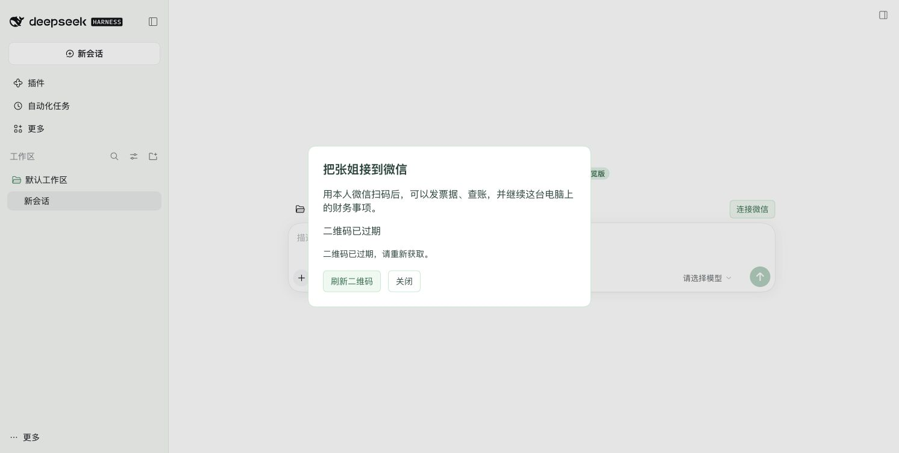

# Open-issue implementation and validation — 2026-11-01

This source change addresses #5, #6, #7, #8, #9 and #11. It is not an npm release or a production deployment.

## Changes and acceptance state

| Issue | Implemented behavior | Evidence / remaining acceptance |
| --- | --- | --- |
| #5 | On-demand authenticated WeChat panel, fresh QR, scanned/connected/expired/error status, refresh and a scoped login tool | Real DSH web UI and real iLink QR issuance, changed QR after refresh, natural expiration and reopen verified. Authenticated route works; unauthenticated access returns 401. Confirmation/restart covered with synthetic iLink. Native Windows/Electron was not rerun. |
| #6 | XLS/XLSX worksheets and rows; text, scanned and mixed PDF pages; explicit continuation; read-only parsing | XLS/XLSX values, multiple sheets, pagination, PDF text/images, invalid files, path escape and cancellation tested. Real model interpretation of the newly generated documents remains unrun. |
| #7 | Persistent local-book tool outcomes, materials and unverified work notes, exposed across sessions | Restart, second database connection, independent-book isolation, sample replacement, stale-reference rejection and rollback tested. An in-flight PDF read cannot journal into a replacement company. Separate homes/computers do not synchronize. |
| #8 | Clarify January vs next month and year; queries cannot become opening/posting requests | Current-preset fresh/existing-session scenarios and explicit-month controls added. **Keep open for real DeepSeek semantic regression.** |
| #9 | Distinguish user requests, explicit promises and completed tool actions; no invented family or persona provenance | Current-preset cases added; historical Q-008 manifests and evidence remain unchanged. **Keep open for real DeepSeek regression and human semantic review.** |
| #11 | First-binding welcome, three encrypted image deliveries, recent factual book activity and persistent per-step progress | Synthetic protocol tests cover image encryption, destination checks, failed-send retry, restart deduplication and preview-vs-posted wording. **Keep open:** real context-free delivery, actual robot remark/avatar menus and saving images require a real account scan. No claim that Tencent accepts a missing context token. |

## Executed locally

Environment: macOS, Node 22.23.1, pnpm 12.3.4, official `@deepseek-ai/dsh@0.2.1-rc.3`. DSH installs, books and browser verification used isolated temporary homes. No hosted CI was enabled or run.

```sh
pnpm install --frozen-lockfile
pnpm build
pnpm typecheck
pnpm lint
pnpm test
node --test packages/dsh-qianlai/tests/wechat-runtime.test.mjs
node packages/dsh-qianlai/scripts/check-dsh-wechat.mjs /absolute/path/to/dsh/lib/bin.js
node packages/dsh-qianlai/e2e/q008/run.mjs --validate
git diff --check
```

- Build, typecheck and lint: passed. Unit tests: **309 core + 79 plugin = 388 passed**.
- Compiled WeChat runtime: ordinary link passed; Windows junction case skipped on macOS.
- Real DSH install/activation with synthetic iLink: QR login and saved-login restart passed.
- Q-008 historical material validation: 24 cases / three variants passed, zero model requests.
- External Chrome: select Zhangjie → connect → request QR → refresh → close/reopen → naturally expired. No plugin console errors were observed. QR/token images are excluded from these public screenshots.





The machine's corepack pnpm launcher needed a temporary executable wrapper around its installed pnpm 12.3.4 `bin/pnpm.mjs`; no repository package-manager setting was changed.

## Model and account limits

The live scenario command was attempted but exited with code 2 because `DEEPSEEK_API_KEY` was unavailable. Relevant local configuration and the configured development read-only environment entrypoint were checked; no usable DeepSeek credential was found. Other-provider credentials were not substituted. This is not a successful model regression and not evidence of a reduced persona failure rate.

After a test key is available, use a new isolated output/home and the current-preset driver:

```sh
# DEEPSEEK_API_KEY must already be in the process environment; never commit it.
DSH_BIN=/absolute/path/to/dsh E2E_JOBS=1 node packages/dsh-qianlai/e2e/run.mjs issues- persona- statement-xlsx statement-invalid-xlsx statement-pdf-
```

`e2e/build-document-fixtures.mjs` regenerates the synthetic XLSX and PDF fixtures. The old fake XLSX fixture now has an explicit invalid-file scenario; the valid XLSX contains two worksheets. Frozen `e2e/q008` data must not be relabeled as tests of the new 27-tool plugin.

For #11, scan a fresh test binding, inspect delivery before sending a message, then verify fallback after an inbound message if required. Check the actual robot settings rather than the user's personal profile. Repeat with/without recent book activity and restart after completed/partially failed delivery. Preserve the issue until those observations are recorded.

## Self-review

Reviewed the complete change including SQL migration, transactions, worker lifetime, upload paths, API authentication, owner binding, protocol image encryption, prompt changes and dependency notices. The added tools expose only the current local book and its WeChat login; they add no general shell, filesystem, arbitrary network or custom-message capability. Notes are explicitly unverified, previews are not posting approval, and current confirmation remains required. Copied financial-core source/tests are unchanged.

Parsing runs outside SQLite write transactions, has a 45-second worker deadline and follows tool cancellation. Successful business changes and their journal records share a transaction. New event IDs are monotonic across sample replacement, so stale references cannot attach to the next company. Network calls have finite deadlines, and generated QR state is discarded on expiration or replacement.

Runtime package licenses checked: SheetJS CE 0.20.3 and pdfjs-dist 6.4.299 Apache-2.0; @napi-rs/canvas 1.1.0 MIT. Existing branded-artwork restrictions remain in force; no broad asset license is granted.
